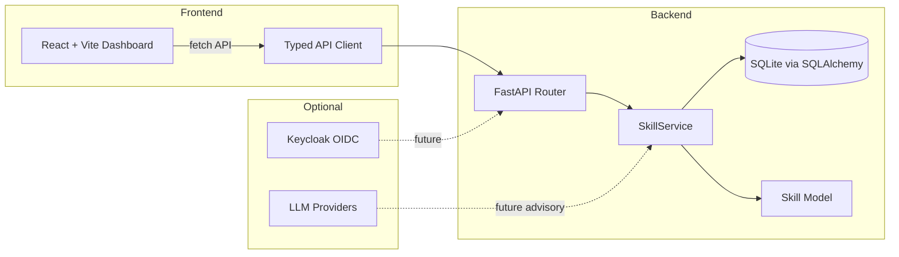

# Lumen Engine | Ryan Vo | AI & Machine Learning

> Work in progress. This checkpoint may be incomplete or fail tests. See PLAN.md and STATUS.md before use.


**Agent harness performance optimization system** — defines, catalogues, and executes skills for Claude Code, Codex, OpenCode, Cursor and beyond.

Developer agents need reusable, versioned capabilities that work across multiple harnesses. Lumen Engine provides a central skill catalog with CRUD, search, and filtering over SQLite, so teams can publish, discover, and execute skills from a single source of truth. A typed frontend dashboard lets operators browse, filter, and manage the skill catalog; the backend exposes a REST API that any harness can integrate with via a lightweight adapter.

Built in Rust/Python with a minimal, deterministic core that works offline — no LLM key required for catalog operations.

## Quick Start

```bash
# Backend
cd backend
python3 -m venv ../.venv
.venv/bin/pip install -r requirements.txt
PYTHONPATH=backend .venv/bin/python -m uvicorn app.main:app --reload

# Frontend
cd ../frontend
npm install
npm run dev
```

## Run with Docker

```bash
docker compose up --build
# Backend: http://127.0.0.1:8000
# Frontend: http://127.0.0.1:3000
# Keycloak: http://127.0.0.1:8080
```

## Tests

```bash
# Backend
PYTHONPATH=backend .venv/bin/python -m pytest backend/tests -v

# Frontend
cd frontend && npm test
```

## API Endpoints

All endpoints are under `/api/v1/`.

| Method | Path | Description |
|--------|------|-------------|
| GET | `/health` | Health check |
| GET | `/version` | App version metadata |
| POST | `/skills` | Create a skill |
| GET | `/skills` | List skills (query: `page`, `per_page`, `harness`, `category`, `is_active`, `search`) |
| GET | `/skills/{id}` | Retrieve a skill |
| PUT | `/skills/{id}` | Update a skill |
| DELETE | `/skills/{id}` | Delete a skill |

## Architecture



**Skill Catalog Workflow**: Users define a skill (name, harness, command, tags) in the frontend. The backend validates the input, normalizes harness aliases and tags, persists the record to SQLite with UTC timestamps, and returns the saved skill. Users can list, search, filter, and paginate skills.

### Skill Model

```
Skill {
  id: UUID
  name: string(200)      # e.g. "explain-code"
  description: string?   # optional human-readable description
  harness: enum          # claude-code, codex, opencode, cursor, generic
  command: string        # shell command to execute
  category: string(100)? # e.g. "documentation", "security"
  tags: string[]         # normalized: lowercased, deduplicated, max 20
  is_active: boolean     # default true
  version: string(50)    # semantic version, default "1.0.0"
  created_at: datetime   # UTC
  updated_at: datetime   # UTC
}
```

## Project Structure

```
lumen-engine-ryan-vo/
├── backend/
│   ├── app/
│   │   ├── main.py          # FastAPI app factory
│   │   ├── api/
│   │   │   ├── routes.py    # Health, skill CRUD routes
│   │   │   └── schemas.py   # Pydantic request/response models
│   │   ├── core/
│   │   │   ├── config.py    # Settings (pydantic-settings)
│   │   │   └── database.py  # SQLAlchemy engine, session, init_db
│   │   ├── models/
│   │   │   └── skill.py     # Skill SQLAlchemy model
│   │   └── services/
│   │       └── skill_service.py  # Business logic
│   ├── tests/               # pytest tests
│   ├── requirements.txt
│   ├── pyproject.toml
│   └── Dockerfile
├── frontend/
│   ├── src/
│   │   ├── main.tsx
│   │   ├── App.tsx
│   │   ├── api/client.ts     # Typed API client
│   │   ├── components/
│   │   │   └── SkillList.tsx
│   │   └── pages/
│   │       ├── SkillCatalog.tsx
│   │       └── SkillDetail.tsx
│   ├── package.json
│   ├── tsconfig.json
│   └── Dockerfile
├── compose.yaml
├── .env.example
├── portfolio.json
└── CHANGELOG.md
```

## AI/ML Evaluation

The skill catalog is the deterministic core engine for agent harness skill delivery. Future AI/ML features (instinct extraction, cross-harness memory, security scanning) are planned as milestones. The current version requires no LLM key for any operation — all data is stored locally in SQLite.

**Reproducible command** (backend tests):
```bash
PYTHONPATH=backend .venv/bin/python -m pytest backend/tests -v
```

## Security Limitations

- **Auth**: OIDC/Keycloak integration is configured in settings but disabled by default (`OIDC_ENABLED=false`). Production deployments MUST enable OIDC and set a strong `SECRET_KEY`.
- **Debug mode**: Default `DEBUG=true` shows SQL query logging. Set `DEBUG=false` in production.
- **Demo mode**: A `demo_mode` flag exists but refuses to start in production environments.
- **Database**: SQLite is used for initial development. Production deployments should migrate to PostgreSQL.
- **CORS**: Configure `CORS_ORIGINS` to match your frontend domain.
- No credentials or secrets are committed to the repository.

## Provider Configuration

| Variable | Default | Description |
|----------|---------|-------------|
| `SECRET_KEY` | dev fallback | JWT signing key. Override in production. |
| `DATABASE_URL` | `sqlite+aiosqlite:///./lumen.db` | Database connection string. |
| `OIDC_ENABLED` | `false` | Enable/disable OIDC auth. |
| `OIDC_ISSUER_URL` | `http://localhost:8080/realms/lumen` | Keycloak issuer URL. |
| `OIDC_CLIENT_ID` | `lumen-engine` | OIDC client ID. |
| `LLM_API_KEY` | (empty) | LLM API key (server-side only, optional). |
| `LLM_PROVIDER` | `openai-compatible` | LLM provider: `openai-compatible`, `anthropic`, `gemini`, `ollama`. |
| `LLM_MODEL` | `gpt-4o-mini` | LLM model name. |
| `CORS_ORIGINS` | localhost:3000 | CORS allowed origins. |

## TLS Reverse Proxy

Deploy behind a TLS-terminating reverse proxy (nginx, Caddy, or Traefik):

```nginx
server {
    listen 443 ssl;
    server_name lumen.example.com;
    ssl_certificate /path/to/cert.pem;
    ssl_certificate_key /path/to/key.pem;

    location / {
        proxy_pass http://localhost:3000;
    }
    location /api/ {
        proxy_pass http://localhost:8000;
    }
}
```

## SSO / SAML Setup (Planned)

Keycloak is included in `compose.yaml` for local development. SAML identity brokering through Keycloak is a future milestone — not yet implemented. When ready, configure:
1. Create a realm in Keycloak
2. Add a SAML identity provider (upstream IdP)
3. Set `OIDC_ENABLED=true`, `OIDC_ISSUER_URL`, `OIDC_CLIENT_ID`, and `OIDC_CLIENT_SECRET`

## Backup and Restore

```bash
# Backup
cp lumen.db backups/lumen-$(date +%Y%m%d).db

# Restore
cp backups/lumen-YYYYMMDD.db lumen.db
```

## License

MIT — see [LICENSE](LICENSE).

---

Ryan Vo (ryandtvo@gmail.com, GitHub: A220man) | AI & Machine Learning